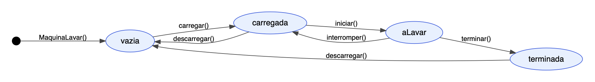

# Ramo `64706`: Lavar roupa numa máquina de lavar

Este ramo é só seu. Contém um pequeno projeto Java 21 / Maven que usa o LiquidJava.

> **Não altere o `Main.java`** (nem sequer espaços ou comentários) **nem a pasta `.github/`.**
> A nota é calculada exclusivamente a partir do registo da GitHub Action *Análise estática
> LiquidJava* do seu PR, que depende das linhas exatas do `Main.java`. Um PR que altere um destes
> ficheiros tem 0 pontos neste exercício.

## A máquina de estados

A máquina começa vazia. Carrega-se a roupa, inicia-se a lavagem e, quando termina, descarrega-se. Também se pode descarregar a roupa antes de iniciar a lavagem, e interromper uma lavagem em curso (a roupa fica na máquina, parada).

Em `src/main/java/pt/ul/fc/MaquinaLavar.java` está a classe `MaquinaLavar`, anotada com `@StateSet` com os estados abaixo.

- `vazia`: vazia
- `carregada`: com roupa, parada
- `aLavar`: a lavar
- `terminada`: lavagem terminada

O protocolo da classe (a *única* fonte de verdade) é este:

| Método | Estado de origem permitido | Estado de destino | O que faz |
|---|---|---|---|
| Construtor `MaquinaLavar()` | — | `vazia` | Cria o objeto. |
| `carregar()` | `vazia` | `carregada` | Carrega a roupa. |
| `iniciar()` | `carregada` | `aLavar` | Inicia a lavagem. |
| `interromper()` | `aLavar` | `carregada` | Interrompe a lavagem; a roupa fica na máquina. |
| `terminar()` | `aLavar` | `terminada` | Termina a lavagem. |
| `descarregar()` | `carregada` ou `terminada` | `vazia` | Descarrega a roupa; a máquina fica vazia. |



O estado inicial é `vazia`. Um método só pode ser chamado nos estados de origem indicados
e, depois de terminar, o objeto fica no estado de destino.

## O que fazer

1. Abra `src/main/java/pt/ul/fc/MaquinaLavar.java`. O método `carregar()` já tem o seu contrato
   (`from="vazia()", to="carregada()"`): serve de exemplo. Os restantes 4 métodos têm
   `@StateRefinement(from="true", to="true")`, que não especifica nada. Preencha, em cada um deles, o `from`
   e o `to` do quadro.
2. Em `src/main/java/pt/ul/fc/Main.java`, os métodos
   `sequencia1()` a `sequencia4()` terminam todos com uma chamada **inválida**, uma por cada método
   que tem de especificar. **Não altere o `Main.java`**: o `main` tem de continuar a chamar os
   métodos da forma errada.
3. Com o ficheiro guardado, confirme no VS Code (extensão LiquidJava) que cada uma das 4 sequências
   inválidas tem **um erro** na última chamada.
4. Não remova o `@StateSet`, não use supressões e não mude as assinaturas dos métodos.
5. Faça *commit* e *push* do seu ramo: `git push origin 64706`.
6. Abra um PR para o repositório original, com o ramo `64706` como destino.

Quando o seu trabalho estiver correto, a GitHub Action **Análise estática LiquidJava** do PR
**falha**: é o resultado esperado, porque o `Main` viola de propósito o protocolo.
Se a Action passar, os seus contratos estão demasiado permissivos.

A nota é dada pelo número de sequências inválidas que o LiquidJava rejeita no registo dessa
Action (até 4 pontos, um por cada método especificado). Confirme no separador *Checks* do PR que a
Action correu.

Use mensagens de *commit* com significado.

## Comandos úteis

```
java -version                 # deve ser JDK 21
mvn -version                  # Maven 3.9 ou superior, com JDK 21
mvn clean compile             # só compila o Java; a verificação LiquidJava é feita pela extensão
git fetch origin
git checkout 64706
git add -A
git commit -m "Mensagem"
git push origin 64706
./setup.sh "Nome" "email"     # configura o git (se ainda não o fez)
```

`mvn compile` não executa o LiquidJava: um projeto que compila pode ter erros de refinamento.
